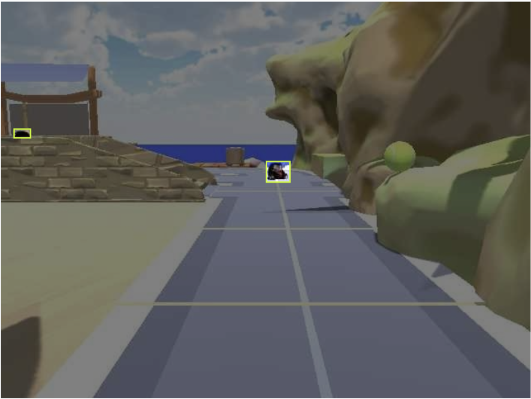
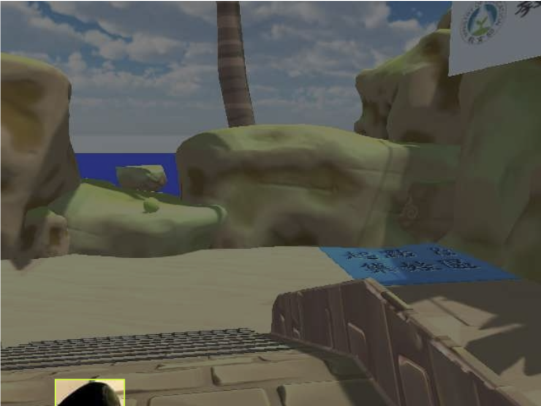
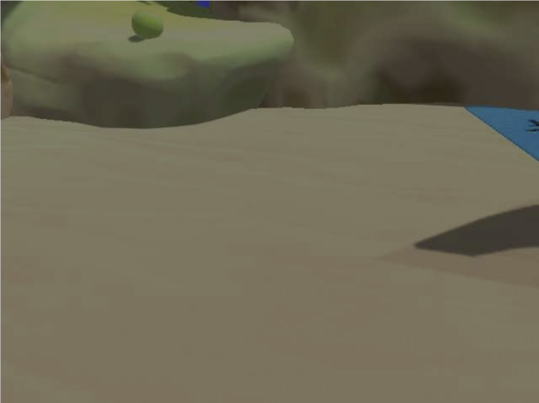

# Perception training record

This record summarizes the existing RNE HW4 report, before integration into the ROS2 mission package. It adds the data and model design behind the README's perception results.

## Dataset coverage

Images were collected from the rover camera in the Unity final-project scene and annotated in Roboflow. The report describes variation in distance, camera angle, background, object size, occlusion and target-free views.

| Task | Labels | Train | Validation | Test | Total |
|---|---|---:|---:|---:|---:|
| Detection | bear, knob | 130 | 39 | 20 | 189 |
| Segmentation | road, bridge | 132 | 38 | 19 | 189 |

| Small targets | Partial target | No target |
|---|---|---|
|  |  |  |

These are dataset / annotation examples. The README's manually driven GIF separately demonstrates inference.

## Model and training choices

| Setting | Detection | Segmentation |
|---|---|---|
| Initial model | YOLO11s | YOLO11m-seg |
| Input image size | 640 | 800 |
| Maximum epochs | 400 | 400 |
| Batch size | 16 | 16 |
| Optimizer | AdamW | AdamW |
| Initial learning rate | 0.001 | 0.001 |
| Final learning-rate fraction | 0.01 | 0.01 |
| Early-stopping patience | 50 | 50 |

The report motivates the smaller detector by inference speed and the larger, higher-resolution segmenter by boundary detail. These are design rationales, without a latency or model-size ablation. Early stopping is recorded; it does not by itself establish that overfitting was prevented.

## Augmentation

| Parameter | Detection | Segmentation |
|---|---:|---:|
| HSV hue | 0.015 | 0.01 |
| HSV saturation | 0.7 | 0.3 |
| HSV value | 0.4 | 0.2 |
| Rotation, degrees | 10 | 3 |
| Translation | 0.1 | 0.05 |
| Scale | 0.5 | 0.25 |
| Shear | 2 | 0 |
| Vertical flip | 0 | 0 |
| Horizontal flip | 0.5 | 0 |
| Mosaic | 1 | 0.2 |
| Mixup | 0.1 | 0 |
| Copy-paste | 0.1 | 0 |

The segmentation settings are more conservative to retain scene/boundary structure, as described in the report.

## Reported evaluation

| Task / split | mAP50 | mAP50–95 | Precision | Recall |
|---|---:|---:|---:|---:|
| Detection / validation | 0.9499 | 0.6359 | 0.9799 | 0.9055 |
| Detection / test | 0.9470 | 0.6193 | 0.9943 | 0.9139 |
| Segmentation masks / validation | 0.8260 | 0.7136 | 0.8888 | 0.7626 |
| Segmentation masks / test | 0.8694 | 0.6751 | 0.9382 | 0.8431 |

These values describe the report's small held-out scene splits. They do not measure performance in new scenes or complete mission success. The later ramp-specific model has no test metric in HW4 and is not evaluated by this table.

## Role in the mission stack

The mission consumes detections and depth for target localization and visual alignment, and uses segmentation information for bridge/ramp behaviors. The report's navigation proposal also mentions reinforcement learning; the repository's mission implementation is described by its actual state machines, without claiming that proposal was deployed.

Source: RNE `HW4/Submit/report.pdf`, pp. 1–3 for configuration/metrics and pp. 3–6 for dataset coverage. No training or inference was rerun for this documentation update.
